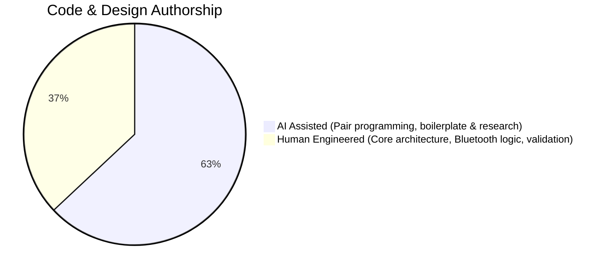
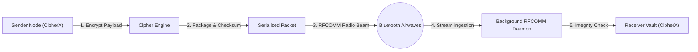

<div align="center">

# CipherX

### Encrypted terminal vault and offline Bluetooth RFCOMM mesh for Windows.

Seven cryptographic engines, statistical letter frequency telemetry, automated English-heuristic brute-force cracking, and serverless peer-to-peer radio messaging over raw Bluetooth RFCOMM sockets.

<br>

<!-- Insert your demo GIF/video here -->

<br><br>


</div>

---

## Why this exists

Modern messaging and secure notes tools almost always demand accounts, remote servers, internet access, or cloud relays. If the internet goes down, you are locked out or silenced.

**CipherX** is an offline terminal application that couples classical cryptography, cryptanalysis utilities, and zero-server hardware-level radio messaging.

- **Offline-First Vault**: Zero external dependencies. Stores encrypted records locally using custom implementations of fundamental computer science data structures.
- **True Peer-to-Peer Airwaves**: Discovers nearby Bluetooth radios and beams encrypted packets directly across RFCOMM channels (`ws2bth.h`) without connecting to any Wi-Fi router, local network, or relay server.
- **Cryptanalytic Intelligence**: Includes an automated heuristic scoring cracker and ASCII letter-frequency distribution visualizer to analyze and break ciphers without knowing the key.

---

## Quick start

Install CipherX in a single command using **PowerShell**:

### PowerShell

```powershell
irm https://raw.githubusercontent.com/iabhnv19/dsproj/main/install.ps1 | iex
```

### Command Prompt (cmd)

```bat
powershell -NoProfile -ExecutionPolicy Bypass -Command "irm 'https://raw.githubusercontent.com/iabhnv19/CipherX/main/install.ps1' | iex"
```

The installer verifies your compiler, compiles the modular C++ binary with Windows Bluetooth libraries, generates a launch shim, and adds it to your user `PATH`.

Once installed, open any terminal and run:

```text
cipherx
```

---

## Authorship Breakdown

Honest and transparent breakdown of how CipherX was built:

<div align="center">



</div>

---

## Cryptographic Engines

CipherX includes seven built-in cryptographic engines covering substitution, polyalphabetic, stream, transposition, and binary encoding:

| Engine | Family | Description | Key / Parameter |
|---|---|---|---|
| **Caesar Shift** | Monoalphabetic Substitution | Offsets each alphabet character by a fixed shift value. Includes an interactive live alphabet-mapping trace. | Shift parameter (1-25) |
| **Vigenere** | Polyalphabetic Substitution | Encrypts alphabetic text using interleaved Caesar shifts determined by letters of a repeating keyword. | Keyword string (1-32 letters) |
| **XOR Stream** | Symmetric Stream Cipher | Performs bitwise XOR transformation on each byte against a secret mask. Payloads are hex-dumped and serialized as clean hex strings. | 8-bit byte mask (1-255) |
| **ROT13** | Symmetric Substitution | Classical 13-step reversible substitution cipher ($ROT13(ROT13(x)) = x$). | None (Fixed 13) |
| **Atbash** | Reciprocal Substitution | Reflects the alphabet onto its reverse ($A \leftrightarrow Z$, $B \leftrightarrow Y$). Reversible without parameters. | None (Fixed reciprocal) |
| **Rail Fence** | Transposition Cipher | Writes plaintext diagonally down and up across imaginary "rails", then reads row by row to scramble letter order without altering character values. | Rail count (2-10) |
| **Base64 Armor** | Binary-to-Text Encoding | Encodes 8-bit binary and string payloads into a radix-64 ASCII representation using a 64-character alphabet. | Standard 64-character alphabet |

---

## Cryptanalysis & Intelligence Suite

CipherX contains a built-in cryptanalysis suite that helps test cipher strength and break encrypted text without a key:

```text
  /// Cracker and Frequency Analysis
  
  1  Brute force an unknown cipher
  2  Letter frequency distribution
  3  Crack message from vault
```

### 1. Automated Heuristic English Cracker
Uses statistical Chi-Square / variance scoring against standard English letter frequencies to automatically rank decrypted permutations.

$$\text{Score} = -\sum_{i=0}^{25} \frac{(O_i - E_i)^2}{E_i + 0.5}$$

Where $O_i$ is the observed percentage of letter $i$ and $E_i$ is standard English frequency. Higher scores indicate natural English grammar.

- **Brute Force Caesar**: Iterates through all 25 shift possibilities in microseconds, scores each candidate, and outputs the top candidates ranked by probability.
- **Brute Force Rail Fence**: Tests depths from 2 to 10 rails and identifies the correct zigzag transposition pattern.
- **Brute Force XOR**: Iterates through all 255 single-byte keys and evaluates the decrypted byte stream against English language benchmarks.

### 2. Frequency Spectrum Analyzer
Visualizes letter distribution using ASCII bar charts and compares observed percentages against standard reference frequencies:

```text
  letters analyzed: 142

  letter   text %   ref %   distribution
    A        8.4%    8.2%   ||||||||||||
    B        1.4%    1.5%   ||
    C        3.1%    2.8%   ||||
    D        4.2%    4.3%   ||||||
    E       12.9%   12.7%   |||||||||||||||||||
    ...
```

---

## Serverless Bluetooth P2P Radio

CipherX communicates directly over Windows Bluetooth sockets (`AF_BTH`, `BTHPROTO_RFCOMM`), bypassing the local network entirely.



### Features of the Bluetooth Subsystem

1. **Background RFCOMM Listener Daemon**:
   - Runs in an asynchronous background thread on boot.
   - Binds to `AF_BTH` and accepts incoming encrypted packet streams.
   - Verifies FNV-1a checksums on arrival, auto-increments unique IDs, buffers records to the queue, and writes to disk.

2. **Hardware Radio Radar (`bthprops.lib`)**:
   - Discovers discoverable or paired Bluetooth nodes in range (~10m).
   - Displays device friendly names alongside hardware MAC addresses (`XX:XX:XX:XX:XX:XX`).

3. **Direct RFCOMM Beam**:
   - Transmits encrypted payloads with zero configuration straight to the remote MAC address.
   - Supports live payload creation or beaming previously stored messages from the archive.

---

## Data Structures Implementation

CipherX demonstrates core data structures implemented in clean C++:

### Singly-Linked List (Timeline Chain)
- Every stored and received message is dynamically allocated into a linked node (`Node* head`).
- Maintains chronological event ordering and enables traversal and history verification.

### Circular Queue (FIFO Dispatch Pipeline)
- Fixed circular array (`queueArr[QUEUE_SIZE]`) managed with `queueFront`, `queueRear`, and wrap-around modulo arithmetic.
- Buffers incoming radio packets and outgoing messages awaiting delivery.

### Open-Addressing Hash Table
- Fast $O(1)$ average message lookups by record ID.
- Uses open addressing with linear probing to resolve collision buckets across a prime-sized table (`INDEX_SIZE = 509`).

### Telemetry Dashboard
Select option `0` (Telemetry) from the menu to inspect live memory usage, buffer allocation, and data structure synchronization:

```text
  vault capacity [################............]  14/250
  pending        [####........................]  4
  delivered      [##########..................]  10

  ciphers used
  Caesar       [######..............]  4
  Vigenere     [###.................]  2
  XOR-Hex      [######..............]  4
  RailFence    [######..............]  4

  data structures
  linked list nodes: 14
  array records:     14
  queue count:       4
  hash index slots:  509 (linear probe)
  bluetooth rfcomm:  online
```

---

## Manual Build

If you cloned the repository or want to compile the source code yourself:

### 1. Prerequisites

A standard C++14 compiler with MinGW-w64 on Windows. If needed, install it in one command using [gcc-auto-setup](https://github.com/iabhnv19/gcc-auto-setup):

```powershell
irm https://raw.githubusercontent.com/iabhnv19/gcc-auto-setup/main/install.ps1 | iex
```

### 2. Build via Make

```bash
make
```

### 3. Build via g++ directly

```powershell
g++ -std=c++14 -O2 -Iinclude src/*.cpp -o project.exe -lws2_32 -lbthprops
```

### 4. Launch

```powershell
.\project.exe
```

---

## Troubleshooting

<details>
<summary><b>"g++ compiler not found on this system"</b></summary>

Install modern GCC with [gcc-auto-setup](https://github.com/iabhnv19/gcc-auto-setup):

```powershell
irm https://raw.githubusercontent.com/iabhnv19/gcc-auto-setup/main/install.ps1 | iex
```
</details>

<details>
<summary><b>"Bluetooth connection failed or peer refused"</b></summary>

- Confirm Bluetooth is turned on in Windows Settings on both devices.
- Verify CipherX is running on the receiving machine so its background listener daemon is active.
- For first-time connections between two computers, pair them once in Windows Settings (`Bluetooth & devices` -> `Add device`) so Windows allows socket communication.
</details>

<details>
<summary><b>Forgotten Master Password / Lockout</b></summary>

CipherX hashes the master passphrase with FNV-1a and stores the hash in `vault.key`. To reset your credentials and set a new password, remove `vault.key`:

```powershell
Remove-Item "$env:LOCALAPPDATA\CipherX\vault.key" -Force
```
</details>

---

## FAQ

**Does CipherX require an active internet connection?**  
No. CipherX is completely offline. Bluetooth communications execute point-to-point over RFCOMM radio channels without accessing the internet.

**Where is the vault database stored?**  
In `messages.txt` inside your working directory or `%LOCALAPPDATA%\CipherX`. Each line represents an encrypted message record sealed with delimiter checks.

**Can I run two instances on the same machine to test?**  
Yes. You can open two separate terminal windows to experiment with ciphers, the cracker, and the telemetry dashboard side-by-side.

---

## Uninstall

To remove CipherX:

```powershell
Remove-Item "$env:LOCALAPPDATA\CipherX" -Recurse -Force
```

Then remove `%LOCALAPPDATA%\CipherX` from your user `PATH` environment variable.

---

## Repository Structure

```text
dsproj/
├── include/              # Public modular headers
│   ├── actions.h         # Interactive menu and prompt controllers
│   ├── bluetooth.h       # Windows Bluetooth RFCOMM daemon and discovery radar
│   ├── ciphers.h         # Cryptographic engine definitions
│   ├── common.h          # Global constants, ANSI colors, utilities
│   ├── cryptanalysis.h   # Frequency distribution and brute-force cracker
│   └── vault.h           # Linked list, circular queue, hash index, storage
├── src/                  # Implementation translation units
│   ├── actions.cpp
│   ├── bluetooth.cpp
│   ├── ciphers.cpp
│   ├── common.cpp
│   ├── cryptanalysis.cpp
│   ├── main.cpp
│   └── vault.cpp
├── install.ps1           # Remote one-line PowerShell bootstrapper
├── authorship.svg        # Authorship breakdown chart
├── Makefile              # Build automation script
├── README.md             # Documentation
├── LICENSE               # MIT License
└── .gitignore            # Excludes build binaries and local keys
```

---

## License & Author

Released under the [MIT License](LICENSE).

<div align="center">

**Made with C++ by [Abhinav](https://github.com/iabhnv19)**

If you found this useful, consider starring the repository!

</div>
